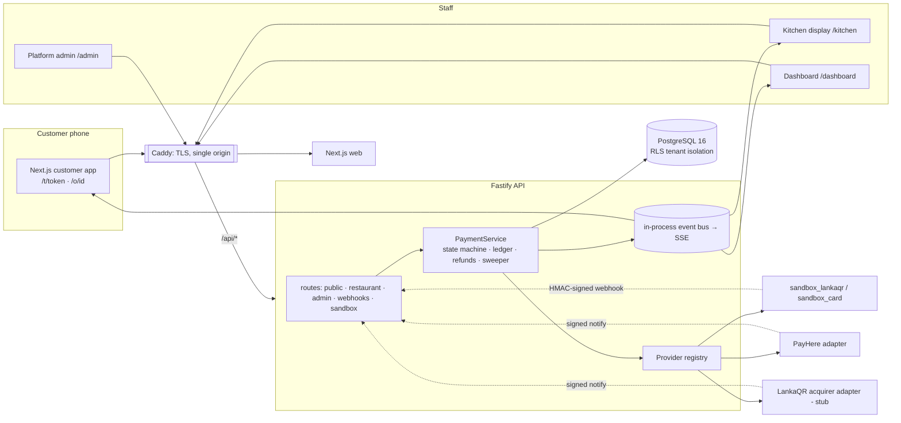

# Architecture

## System view

## Stack and the deliberate deviations from the brief

| Brief | Built | Why |
|---|---|---|
| NestJS "or equivalent" | **Fastify 5 + TypeScript + zod**, modular route/service files | Smaller, faster cold start on cheap hosting; same module boundaries (routes → services → db). Easy to port to NestJS modules if the team prefers |
| WebSockets or managed realtime | **Server-Sent Events** (+ polling safety net) | One-way server→client is all we need; auto-reconnect is built in; passes proxies and flaky mobile networks better than WebSockets. **Single API instance only** — swap `events.ts` for Postgres `LISTEN/NOTIFY` or Redis pub/sub before running >1 replica |
| PostgreSQL | PostgreSQL 16 (`pg`), with embedded **PGlite** for zero-install dev | Tested on both; production = real PostgreSQL |
| Auth | httpOnly `SameSite=Lax` cookie (JWT) + CSRF header; Bearer for API clients | No tokens in JS-reachable storage |

## Multi-tenancy (strict isolation, two independent layers)

1. **Application scope** — every DB call goes through `db.tx(scope, fn)`. A scope is `tenant(restaurantId)` (derived from the authenticated user, or from the table token / order tracking token for customers) or `SYSTEM` (webhooks, sweeper, platform admin).
2. **PostgreSQL row-level security** — every tenant table has a policy keyed on `app.tenant_id`. Inside each transaction the app runs `SET LOCAL ROLE tf_app` (an unprivileged role) and sets the scope via `set_config(..., true)`. A query that forgets its `WHERE restaurant_id = …` still cannot see another restaurant's rows; writes to another tenant fail with *"violates row-level security policy"*. This is covered by tests (`test/security.test.ts`).

Customers have no account. Authority comes from **unguessable capability tokens**: the table QR token (128-bit, rotatable) lets someone *see the menu and place an order* at that table; the per-order `tracking_token` (192-bit) lets someone *view/pay that one order*.

Defence in depth beyond RLS: users and restaurants are re-checked **on every request** (suspending a restaurant or disabling a user takes effect immediately); roles map to explicit permissions (`auth.ts`); platform roles have no restaurant and can't reach `/api/r/*`.

## Roles

| Role | Can |
|---|---|
| `owner` | everything for their restaurant incl. staff, settings, payment-method toggles |
| `manager` | menu, tables, payments, **refunds**, reconciliation, reports (not staff/settings) |
| `cashier` | orders, payment list, feedback (no refunds) |
| `kitchen` | kitchen display / order status only |
| `platform_admin` | approve/suspend restaurants, plans, providers, go-live, exports |
| `platform_support` | read-only platform + support tickets |

## Real-time flow

`PaymentService.afterApply()` publishes to `r:<restaurantId>` (kitchen/dashboard) and `o:<orderId>` (the customer's phone). Clients connect with `EventSource`; each page also polls (3–10 s) so a dropped stream degrades to polling, never to a stale screen. **The customer's page never trusts its own state:** it flips to "received" only when the server says the order is paid.

## Background work

`PaymentService.sweep()` runs every 15 s in `server.ts`: status-enquires every still-open payment (so a lost webhook is recovered), expires payments past their deadline, and expires abandoned unpaid orders after 30 min.

## Security controls (where they live)

| Control | Implementation |
|---|---|
| HTTPS everywhere, HSTS, CSP | Caddy (`infra/Caddyfile`); `helmet` on the API |
| Verified webhooks | per-provider HMAC / md5sig check over the **raw body**, timestamp window, event-id dedupe, atomic with the state change (`payments/service.ts#handleWebhook`) |
| Idempotency | `Idempotency-Key` on order, payment and refund creation; unique constraints back them |
| Transaction integrity | `SELECT … FOR UPDATE` on payment/order rows; partial unique index `payments_one_paid_per_order` |
| Rate limiting | `@fastify/rate-limit` (global 300/min; login 10/min; order create 12/min; webhooks 600/min) + account lockout after 5 failed logins |
| Encrypted secrets | provider credentials AES-256-GCM (`SECRETS_KEY`), write-only, never returned by any endpoint |
| Audit log | append-only (`tf_app` has no UPDATE/DELETE) for logins, menu/price edits, status changes, refunds, approvals, provider changes |
| Immutable ledger | trigger rejects UPDATE/DELETE even for the owner role |
| Password storage | scrypt (N=16384) per-user salt; constant-ish-time login for unknown emails |
| Upload safety | 2 MB cap, magic-byte check (JPEG/PNG/WebP), random filenames, `nosniff` |
| CSV export safety | leading `= + - @` neutralised (formula injection) |
| No card data | there is no column, field or endpoint that can hold a PAN/CVV; card entry happens only on the provider's hosted page |
| Privacy-aware retention | customer name/phone/email are optional; see `PRODUCTION-CHECKLIST.md` for the retention job to add |

## Performance on affordable phones

Menu is one request (~15 KB JSON), first-load JS ≈ 120 kB, images lazy-loaded SVG/JPEG, no client state library, system fonts (no webfont download — important for Sinhala/Tamil on cellular), `prefers-reduced-motion` respected, SSE + 3 s polling fallback.
