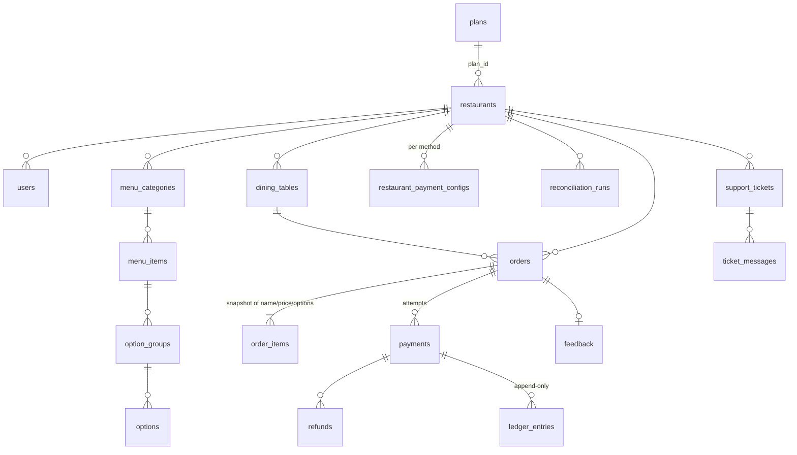

# Database schema

Source of truth: [`apps/api/src/migrations.ts`](../apps/api/src/migrations.ts). PostgreSQL ≥ 13. **Money is `integer` minor units (LKR cents)** — never floats.



## Tables

| Table | Notes |
|---|---|
| `plans` | subscription plan: monthly fee, per-transaction fee (bps), table limit |
| `restaurants` | `status` pending→active/rejected, suspended; service-charge & tax (bps), `branding` jsonb (logo, colours, font, theme), `order_seq` for human order numbers |
| `users` | `restaurant_id` NULL ⇒ platform staff. scrypt hash, lockout counters. Unique on `lower(email)` |
| `dining_tables` | `token` = what the QR encodes (unguessable, rotatable) |
| `menu_categories/items`, `option_groups`, `options` | names/descriptions are `{"en","si","ta"}` jsonb; options carry price deltas; groups have min/max (min 1 = required) |
| `orders` | totals computed **server-side**; `status` (pending_payment, received, preparing, ready, served, cancelled, expired) and `payment_status` (unpaid, paid, partially_refunded, refunded); `tracking_token`; unique `(restaurant_id, idempotency_key)`; `mode` sandbox/live |
| `order_items` | immutable snapshot (name, unit price, options) so later menu edits never rewrite history |
| `payments` | one row per **attempt**. Status: created, pending, requires_action, **paid**, **paid_duplicate**, failed, cancelled, expired. `provider_data` holds only QR payload / redirect URL — never card data. Partial unique index guarantees **at most one `paid` payment per order** |
| `payment_events` | inbound webhook log + dedupe, unique `(provider, event_id)`; rejected deliveries are logged too |
| `refunds` | status pending/succeeded/failed/unsupported; unique `(payment_id, idempotency_key)` |
| `ledger_entries` | **append-only** (trigger). kinds: charge, gateway_fee, refund, platform_fee_accrued / _deducted, duplicate_charge, settlement, adjustment. Signed from the restaurant's view |
| `restaurant_payment_configs` | per restaurant per method: provider, enabled, `mode` sandbox/live, `settlement_model` direct/marketplace, non-secret `config`, **`secret_enc` (AES-GCM)**, `fee_bps`, `live_approved_at/by` |
| `reconciliation_runs` | persisted reconciliation reports |
| `feedback`, `support_tickets`, `ticket_messages`, `outbox` | self-explanatory; `outbox` records receipt "sends" (delivery is simulated in the prototype) |
| `audit_log` | append-only (insert/select only for the app role) |
| `platform_settings`, `sandbox_txns` | sandbox controls and the **simulated provider-side ledger** (stands in for the bank) |

## Row-level security

All tenant tables (`restaurants`, `users`, `dining_tables`, `menu_*`, `option*`, `orders`, `order_items`, `payments`, `refunds`, `ledger_entries`, `restaurant_payment_configs`, `reconciliation_runs`, `feedback`, `support_*`, `ticket_messages`, `outbox`, `audit_log`) have `FORCE ROW LEVEL SECURITY` and one policy:

```sql
USING (current_setting('app.scope', true) = 'system'
       OR restaurant_id = nullif(current_setting('app.tenant_id', true), '')::uuid)
```

In production connect as a login role that is a member of `tf_app` but **not** a superuser (superusers bypass RLS; the migration role should be separate from the runtime role).
