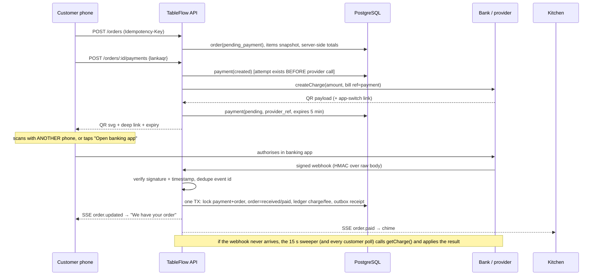
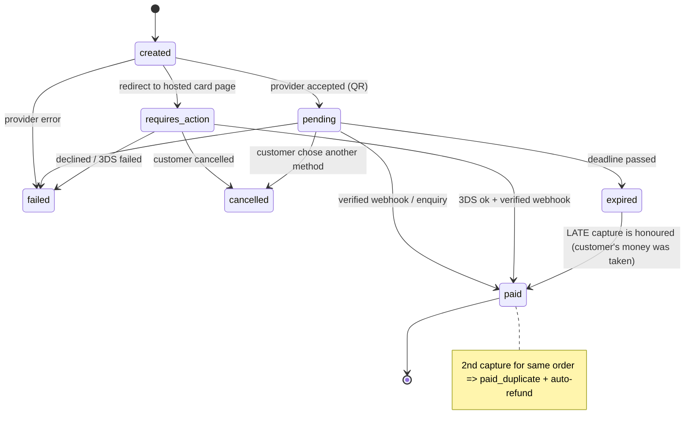

# Payment integration architecture

## Provider abstraction

```ts
interface PaymentProvider {
  key; method: 'lankaqr' | 'card'; sandbox: boolean; capabilities;      // dynamicQr, deepLink, statusEnquiry, refunds, marketplaceSplit…
  checkAvailability(ctx)            // is this method usable right now for this restaurant?
  createCharge(ctx, req)            // → providerRef + QR payload / deep link / hosted-checkout redirect
  getCharge(ctx, ref)               // server-side status enquiry (source of truth when a webhook is late/lost)
  peekRef(headers, rawBody)         // unverified: which payment does this webhook claim to be about?
  verifyWebhook(ctx, headers, raw)  // throws unless authenticity is proven; returns a normalised event
  refund(ctx, ref, amount, reason, idempotencyKey)
  listTransactions?(ctx, from, to)  // for reconciliation
}
```

Each restaurant has its own **merchant configuration** (`restaurant_payment_configs`: provider, merchant id, encrypted credentials, fee, mode, settlement model). `PaymentService.loadCtx()` decrypts credentials in memory per call and refuses: sandbox providers in `live` mode; `live` mode without explicit platform approval.

| Adapter | Method | Status |
|---|---|---|
| `sandbox_lankaqr` | LankaQR | Simulated bank. Builds a real **EMVCo dynamic QR** (tag 01=12, currency 144, amount, bill ref, CRC-16) with a deliberately fake network GUID so it can't be paid by a real app |
| `sandbox_card` | Card | Simulated hosted checkout + 3-D Secure + signed webhooks |
| `payhere` | Card | Hosted checkout (POST form) + `md5sig` notify verification, from PayHere's published scheme. **Unverified against PayHere's live sandbox.** No refund API (needs OAuth merchant credentials) |
| `lankaqr_acquirer` | LankaQR | **Integration seam**: reports unavailable (`not_configured` → `dynamic_qr_not_implemented`) so customers get card checkout. Implement against the acquiring bank's sandbox after merchant onboarding |

## Customer flow (LankaQR, dynamic)



**An order is never marked paid from the browser.** There is no "I've paid" endpoint. Only (a) a verified provider webhook, (b) a server-side status enquiry, or (c) a reconciliation run can move a payment to `paid`.

**Same-phone problem:** a phone cannot scan its own screen, so the payment page also offers *Open banking app* (`deepLink`) where the provider supports an app-switch / payment-link. If a provider has no such capability, set `capabilities.deepLink=false` and the button is not shown.

## Payment state machine



* **Duplicate protection:** switching method cancels the old attempt locally, but the customer's banking app may still pay it. If a second capture arrives for an already-paid order it is stored as `paid_duplicate` (ledger `duplicate_charge`), flagged `needs_refund`, and an automatic refund is attempted. The partial unique index makes a second `paid` row for one order physically impossible.
* **Amount mismatch:** a capture whose amount differs from what we asked for is *never* fulfilled — it is flagged `amount_mismatch` / `needs_refund`.
* **Expiry:** QR attempts live 5 min, card attempts 15 min. Expired orders can be re-paid with a fresh attempt.
* **Idempotency:** order create (key per cart), payment create (key per attempt; also reuses a live same-method attempt), refund (key per refund).

## Fallback to card

`GET /public/t/:token/methods` hides methods the restaurant hasn't configured, and flags configured-but-down ones. A provider is "down" if `checkAvailability` says so, or the **circuit breaker** opened (3 consecutive provider failures → 60 s cool-down). The UI then shows *"LankaQR is temporarily unavailable. You can securely complete your payment using a credit or debit card."* and pre-selects card. If `createPayment` hits a provider error mid-flight the API replies `409/503 … fallback: "card"`.

## Settlement models

* **Direct merchant settlement (default MVP):** money settles straight to the restaurant's acquiring account. TableFlow's fee is written to the ledger as `platform_fee_accrued` (a receivable) and **invoiced separately** — never deducted.
* **Marketplace / split settlement:** selectable **only** if the provider's `capabilities.marketplaceSplit` is true (none of the shipped adapters claim it). Recorded as `platform_fee_deducted`. Requires written confirmation from the provider/regulator arrangement before enabling a provider's capability flag.

## Ledger, refunds, reconciliation

* `ledger_entries` is append-only and signed from the restaurant's view: `charge +`, `gateway_fee −`, `platform_fee_* −`, `refund −`, `duplicate_charge +`.
* **Refunds:** `POST /r/payments/:id/refund` (owner/manager). Partial or full, over-refund blocked (including in-flight refunds), idempotent. If the provider can't refund by API the refund is recorded `unsupported` and staff can **record a manual refund** made in the provider's portal.
* **Reconciliation:** `POST /r/reconcile` compares our payments with `provider.listTransactions()`:
  provider captured / we didn't → **healed** (applied now); we paid / provider didn't → flagged; amount or refund mismatch → flagged; provider settlement info → `settlement_status = settled`. Runs are stored and exportable.
* Exports: ledger CSV per restaurant; transactions / failed / revenue / restaurants CSV for the platform.

## Going live (per restaurant, per method)

1. Merchant agreement + KYC with the acquirer/PSP (outside this codebase).
2. Implement/verify the adapter against the provider's **sandbox**; run the provider's test matrix (success, decline, 3DS, timeout, refund, expiry, duplicate callback).
3. Admin → Restaurants → Payments → *Configure* (merchant id + credential, encrypted) → provider is forced back to `sandbox`.
4. Admin → *Go live…* requires all four checklist boxes (agreement signed, sandbox tests passed, settlement account verified, webhook verified in provider sandbox) and a non-sandbox provider with credentials. Only then does `mode='live'` + `live_approved_at` get set.
5. Set `ALLOW_SANDBOX=false` in production so the sandbox providers don't even load.
